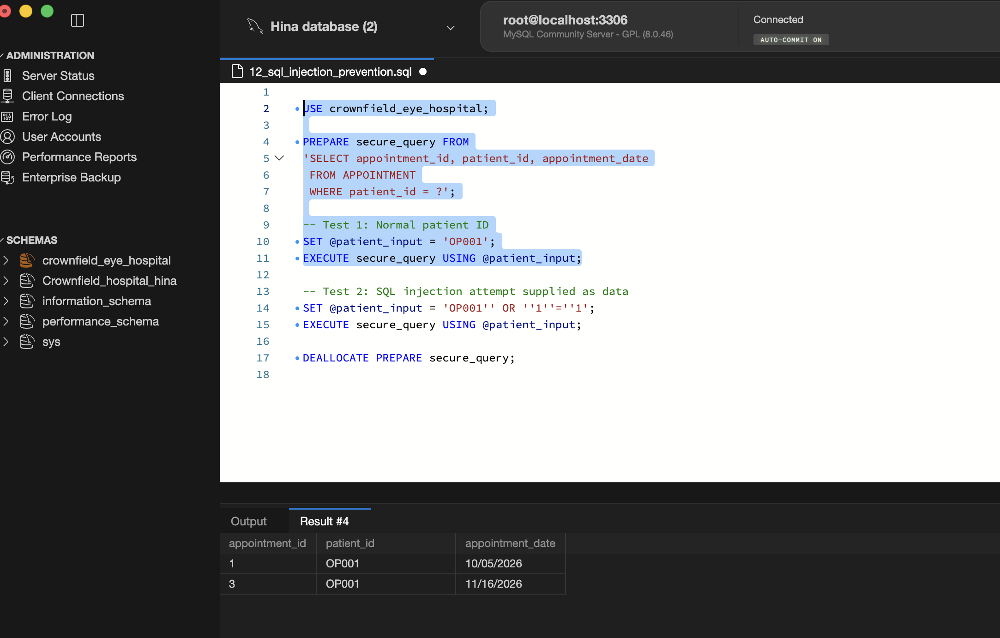

# Crownfield Eye Hospital — Database Development

Module: CPU4103 — Introduction to Database

Student: Hina Javed

Database platform: MySQL 8.0 / MySQL Workbench

Project type: Individual SQL submission based on a collaborative database design
## Project overview
This repository contains the database schema, sample data, individual SQL features, security controls and tests for a fictional ophthalmology database prototype for Crownfield Eye Hospital. It models patients, clinicians, clinics, appointments, diagnoses, prescriptions, medicines and follow-up plans.

The project uses fictional and clearly labelled synthetic test data. It is not a production hospital system or a source of clinical advice.
## Individual contribution
My work includes conceptual, logical and physical ER diagrams; normalisation from unnormalised form (UNF) to third normal form (3NF); SQL table creation and population; four individual SELECT queries; a parameterised stored procedure; follow-up validation triggers; role-based access control; a patient-specific view; encryption demonstration; and transaction tests.

The eleven core tables are PATIENT, SPECIALTY, CLINICIAN, CLINIC, APPOINTMENT, DIAGNOSIS, APPOINTMENT_DIAGNOSIS, PRESCRIPTION, MEDICINE, PRESCRIPTION_ITEM and FOLLOW_UP_PLAN.

PATIENT_DB_ACCOUNT and ENCRYPTED_NOTE_DEMO are additional demonstration tables used for security and data protection.
## Requirements
- MySQL 8.0 with InnoDB support and MySQL Workbench (or an equivalent MySQL client).
- A database account permitted to create schemas, tables, foreign keys, views, stored procedures, triggers, roles and local test accounts. Some steps require administrator-level privileges.
- A fresh disposable coursework environment. Do not run these scripts against real patient data or a production database.
## SQL files and execution order
Run the main scripts in the order shown below. Open each script in MySQL Workbench and execute its statements as described; certain negative tests must be run individually.

| Order | SQL file | Purpose and notes |
|:--:|---|---|
| 1 | `01_table_creation.sql` | Create the `crownfield_eye_hospital` database, the eleven core tables, primary and foreign keys, and constraints. **Caution:** this script drops existing core tables before recreating them. |
| 2 | `02_data_population.sql` | Insert the five source appointment examples and additional clearly identified synthetic records. |
| 3 | `03_update_delete_testing.sql` | Demonstrate controlled `UPDATE`, `DELETE` and an orphan-reference check. The temporary test patient is deleted by the script. |
| 4 | `04_orphan_reference_test.sql` | Check that appointments reference existing patients, clinicians and clinics. Expected result: **zero orphan rows**. |
| 5 | `05_individual_queries.sql` | Execute four queries separately: `GROUP BY`/`HAVING`, a four-table `INNER JOIN`, a `LEFT JOIN`, and a correlated subquery. |
| 6 | `06_procedure_creation.sql` | Create the parameterised stored procedure `sp_patient_appointments`. Test it using `CALL sp_patient_appointments('OP001');` in Workbench. |
| 7 | `07_triggers_and_testing.sql` | Create the follow-up date validation triggers and test valid/invalid dates. **Execute test statements in sections:** deliberately invalid `INSERT` and `UPDATE` operations should fail; then verify and clean up the temporary records. |
| 8 | `08_security.sql` | Create four database roles, assign privileges, map example patient accounts to patient IDs, create the patient-filtered appointment view, and provision local demonstration logins. Requires appropriate MySQL privileges. |
| 9 | `09_patient_security_testing.sql` | Run the account-mapping check as an administrator, then run patient-specific view checks and intended access-denial tests using the patient test login. **Do not execute the entire script as one administrator session.** |
| 10 | `10_data_protection.sql` | Demonstrate AES-256-CBC encryption and decryption of a synthetic note using HKDF and random key/IV/salt values. Run generation, encryption and decryption in the **same MySQL session**. |
| 11 | `11_transactions.sql` | Demonstrate `ROLLBACK` reversing an update and `COMMIT` preserving an update, followed by synthetic-data clean-up. |

## Supporting SQL scripts
These are supplementary files, not additional mandatory execution steps:
File	Purpose
| File | Purpose |
|---|---|
| `90_select_all_tables.sql` | Display the contents of the eleven core tables for inspection. |
| `91_date_format_display.sql` | Display appointment dates in a formatted `SELECT`; it does **not** modify stored dates. |
| `92_procedure_execution_alternative.sql` | Contains the procedure call **and duplicate trigger creation/testing**. This is an alternative demonstration file; **do not run it in full after `07_triggers_and_testing.sql`**. Use the stand-alone `CALL` above to test the procedure instead. |

### Report screenshot filenames

The SQL scripts were renamed with numeric prefixes for a clearer GitHub execution order. Screenshots in the submitted assessment report may show their original filenames. The numbered scripts represent the same SQL work, so the screenshot filenames may differ from the current repository filenames.
## Individual SQL features (Part C)
1. Aggregation: GROUP BY and HAVING identify clinicians with at least two appointments.
2. Four-table INNER JOIN: joins appointments with patients, clinicians and clinics.
3. LEFT JOIN: shows appointments, including those without prescriptions.
4. Correlated subquery: identifies patients who have more than one appointment.
5. Stored procedure: sp_patient_appointments(IN p_patient_id VARCHAR(10)), demonstrated for OP001.
6. Triggers: trg_validate_followup_date_insert and trg_validate_followup_date_update prevent due dates earlier than appointment dates. For an invalid date they set NEW.due_date to NULL, and the table's NOT NULL constraint rejects the operation; those errors are expected test results.
The individual assessment report explains the purpose of each feature and includes executed SQL and result screenshots.
## Security and data protection (Part D)
Four database roles demonstrate different privileges: hospital_admin_role, doctor_role, receptionist_role and patient_role.

The patient role receives SELECT on v_patient_appointments rather than direct access to the underlying patient and appointment tables. The view uses PATIENT_DB_ACCOUNT to restrict returned appointments to the current database username. The security tests demonstrate access to the patient's own appointments, an empty result for another patient, and expected denial of direct table access.

10_data_protection.sql demonstrates AES_ENCRYPT() and AES_DECRYPT() using AES-256-CBC, HKDF, a random IV and salt. The randomly generated encryption key exists only in a session variable. This is a coursework demonstration, not production key management.

Demonstration credentials: 08_security.sql contains fixed example passwords for local fictional test accounts only. They are not intended for real accounts or network-exposed installations; do not reuse them for any real service. If any password has been used outside the isolated test environment, change it before publishing. GitHub commit history may retain earlier versions of a file.

## Optional Extra-Credit: SQL Injection Prevention

### Purpose

This demonstration shows how parameterised SQL queries
can help prevent SQL injection attacks.

### SQL File

`12_sql_injection_prevention.sql`

This script uses a MySQL prepared statement with a
parameter placeholder (?) to retrieve appointments
for a specified patient.

### Testing

Test 1 — Valid patient ID:
- Input: OP001
- Expected result: Two appointment records.

Test 2 — Injection-like input:
- Input: OP001' OR '1'='1
- Expected result: Zero rows.
- Explanation: The input is treated as data rather
  than being executed as part of the SQL query.

### Screenshot Evidence

Normal input:

Injection prevention test:

### Security Conclusion

Prepared statements separate SQL instructions from
user-supplied values. Parameter binding helps prevent
an attacker from changing the intended query logic.

This is an additional secure-coding demonstration
for Part D of the CPU4:103 assessment.

## Testing notes and limitations
- The original appointment examples are taken from the fictional assessment scenario. Additional rows are labelled as synthetic test data.
- The source postcode for OP001 is NE1 4AB, which is used in the corrected population script.
- Where the source does not provide dose, route, frequency or duration, the seed data uses explicit source data not provided placeholders rather than inventing medical instructions.
- The source's follow-up intervals were converted to due dates; Planned was used as the assumed initial status.
- An appointment without a medicine is represented without a prescription record.
- Negative trigger tests are deliberately expected to raise errors; subsequent verification and cleanup statements should be executed separately.
- Some access-control tests must be performed with different MySQL connections (administrator versus patient), not in a single session.
- The demonstration does not claim clinical validation or production-grade security.
Re-running the project
01_table_creation.sql drops and recreates the eleven core tables. Later security and encryption scripts create PATIENT_DB_ACCOUNT and ENCRYPTED_NOTE_DEMO, which have foreign keys to core tables. After those extensions exist, rerunning the schema script against the same database can fail because of those dependencies. The safest approach is to use a fresh disposable MySQL database environment and follow the execution order above.
## ER diagrams and evidence
The repository includes the editable conceptual, logical and physical ER diagrams along with the SQL scripts and this README. Diagram filenames may differ from the numbered SQL files. The Word assessment report contains the diagrams, explanations, and MySQL Workbench screenshots used as evidence.
## Attribution
The initial database design was developed collaboratively. The SQL implementation, individual query features, security and transaction demonstrations, and associated report evidence are presented as my individual contribution. The academic and MySQL documentation references appear in the assessment report.
